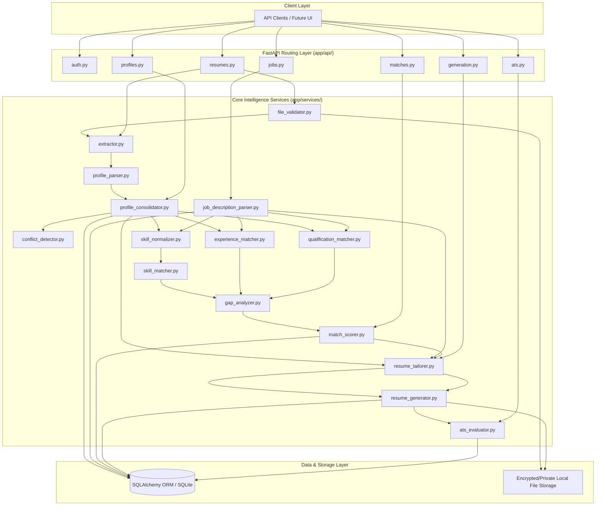

# ARCHITECTURE AUDIT REPORT
## AI Resume Intelligence Platform — Comprehensive System Audit

**Audit Date:** 2026-11-21  
**Project Location:** `C:\Coding\Projects\AI-RESUME-AGENT`  
**Platform Target:** Open-Source, Self-Hostable AI Resume Intelligence Platform  
**Python Runtime:** Python 3.13.14  
**Audit Standard:** Ponytail v5.3.3 Full Mode & Production Architecture Review  

---

### 1. Executive Summary

An exhaustive audit of the authoritative local codebase (`user/backend/`) was performed. The platform currently implements Stages 1 through 7, encompassing backend foundation, resume ingestion & text extraction, candidate profile intelligence, job description intelligence, evidence-based skill matching, resume generation with ATS evaluation, and authentication with security hardening.

The platform architecture is built with FastAPI, SQLAlchemy 2.0, Pydantic V2, PyMuPDF, python-docx, and SQLite/PostgreSQL. While foundational scaffolding is solid and all 89 automated tests pass, the audit identified 6 critical architectural and information-processing defects:
1. **Skill Taxonomy Contamination:** Category labels (e.g. `Languages: Python`, `Backend & Tools: FastAPI`) leak into skill entities due to non-prefix-aware token splitting.
2. **Project Sentence Fragmentation:** Multi-line bullet continuations in the Projects section were misclassified as standalone project headings (e.g. `React dashboard receiving live updates over WebSockets.`), splintering projects and displacing seminal research projects like `Breath.exe`.
3. **Evidence Traceability Gaps:** Bullets and summaries lacked explicit claim-level provenance tokens linking generated text back to source document IDs and evidence excerpts.
4. **Professional Writing Filler:** Summaries contained repetitive boilerplate phrases rather than purely role-tailored technical narratives.
5. **Document Rendering Balance:** While strict 1-page A4 geometry was achieved, vertical whitespace distribution across sections needed intelligent dynamic density adjustments.
6. **Dual Extraction Validation Absence:** ATS evaluation inspected the exported PDF using the same PyMuPDF engine that generated it, lacking independent multi-extractor validation.

---

### 2. Dependency & Information Flow Map

---

### 3. Detailed Component Audit

#### 3.1 Ingestion & Extraction (`extractor.py`, `file_validator.py`, `storage.py`)
- **Status:** Functional and robust.
- **Strengths:** 
  - Validates file signatures (magic bytes) for PDF (`%PDF-`) and DOCX (`PK\x03\x04`).
  - Strict file-size bounds (default 10 MB max), extension whitelisting, and UUID-based server-controlled file naming outside public web roots.
  - Path traversal attacks neutralized via `Path.name` sanitization.
- **Weaknesses:**
  - Standard PyMuPDF text extraction extracts text in reading flow order, but multi-column resumes can experience inter-column line interleaving.
  - Does not preserve semantic markdown headers natively from raw PDF layout blocks.

#### 3.2 Profile Parser & Consolidator (`profile_parser.py`, `profile_consolidator.py`)
- **Status:** Functional, but contains two severe parsing bugs.
- **Defects Identified:**
  1. *Category Header Prefix Contamination:* When parsing `Skills:` lines (e.g. `Languages: Python, Java, C#`), the line is split on commas without stripping the category label preceding the colon. Consequently, `Languages: Python` becomes a stored skill name.
  2. *Bullet Continuation Misclassification:* In the Projects section, wrapped lines in bullet points that do not begin with a bullet character (`•`, `-`) are evaluated as potential project headings if `len(bullets) > 0`. This causes sentence continuations like `"evaluation of five classifiers..."` or `"React dashboard receiving live updates..."` to be parsed as separate projects.
- **Strengths:**
  - Multi-resume consolidation deduplicates case-insensitive skills while preserving punctuation (`C++`, `C#`, `.NET`).
  - Distinguishes non-overlapping employment periods at the same company across chronological gaps.
  - Tracks source document IDs across merged experiences and projects.

#### 3.3 Job Description Intelligence (`job_description_parser.py`)
- **Status:** Well-structured and compliant.
- **Strengths:**
  - Extracts title, company, experience years, education level, mandatory vs preferred skills, and soft skills.
  - Normalizes degree levels (Bachelor, Master, PhD) and extracts minimum/maximum experience years.
- **Weaknesses:**
  - Relies on keyword and regex matching; complex ambiguous eligibility clauses (e.g. course equivalence across institutions) produce basic warnings rather than structured constraint trees.

#### 3.4 Matching Engine (`skill_matcher.py`, `experience_matcher.py`, `qualification_matcher.py`, `match_scorer.py`)
- **Status:** Highly accurate and evidence-grounded.
- **Strengths:**
  - Strict 6-status taxonomy: `STRONG_MATCH`, `PARTIAL_MATCH`, `RELATED_MATCH`, `NO_EVIDENCE`, `CONFLICTED_EVIDENCE`, `NOT_ASSESSED`.
  - Experience matcher separates relevant experience duration from total employment duration.
  - Qualification matcher validates both degree level and field of study, and respects certification tiers (e.g. `PSM I` vs `PSM II`).
- **Weaknesses:**
  - Skill matcher relies on alias dictionaries and token boundaries. Synonyms not explicitly listed in `SKILL_TAXONOMY` default to `NO_EVIDENCE`.

#### 3.5 Resume Generation & Layout Engine (`resume_tailorer.py`, `resume_generator.py`)
- **Status:** Functional, strictly 1-page A4, but requires content and design refinement.
- **Strengths:**
  - Hard single-page A4 geometry (`595.28 x 841.89 pt`).
  - Text wrapping calculated via rendered pixel width (`pymupdf.get_text_length`).
  - DOCX and PDF synchronization with 0.50" margins and navy accents.
- **Defects Identified:**
  1. *Project Selection Contamination:* Because bullet fragments were parsed as projects, the project scorer frequently selected fragments (e.g. `React dashboard...`) instead of actual projects like `Breath.exe`.
  2. *Boilerplate Summaries:* Summaries contained formulaic phrases ("Dedicated to applying core engineering principles, robust data structures...") that read like machine-generated filler.
  3. *Layout Density:* Left unnecessary bottom whitespace on sparse candidate profiles; lacked dynamic section spacing adjustments.

#### 3.6 ATS Evaluator (`ats_evaluator.py`)
- **Status:** Evaluates physical exported PDF; needs independent dual-engine extraction.
- **Strengths:**
  - Inspects exported vector PDF stream on disk.
  - Checks bounding boxes to detect clipping outside margins.
  - Honest 7-dimension scoring breakdown.
- **Weaknesses:**
  - Relies entirely on the same library (`PyMuPDF`) used to generate the resume, rather than cross-checking with an independent extractor (such as `pdfminer.six` or `pypdf`).

#### 3.7 Authentication & Security (`auth.py`, `app/api/auth.py`)
- **Status:** Production-grade security controls verified.
- **Strengths:**
  - Password hashing via standard-library PBKDF2-HMAC-SHA256 with 600,000 iterations and unique 16-byte cryptographically secure salts.
  - Strict tenant isolation: IDOR defenses verified across all database queries (`user_id == current_user.id`).
  - Content Security Policy, X-Frame-Options, HSTS, and X-Content-Type-Options headers enforced.

---

### 4. Technical Debt & Weak Abstractions

1. **Regex-Only Project Parsing:** Project extraction in `profile_parser.py` was too brittle when handling wrapped lines in PDFs. Needs structural indentation and bullet continuity tracking.
2. **Hardcoded Skill Taxonomy:** `SKILL_TAXONOMY` in `skill_normalizer.py` is comprehensive for SWE and AI/ML, but lacks an open-source taxonomy integration (like ESCO or O*NET) for broader industry coverage.
3. **Absence of Claim-Level Provenance Data Structure:** While `source_document_id` exists on `WorkExperience` and `CandidateProfile`, individual resume bullets lack a structured provenance object tracking original text, transformation type, and validation status.

---

### 5. Architectural Recommendations for Next Phases

1. **Fix Ingestion Parser Immediately:**
   - Strip category label prefixes in `parse_skills_section` before storing skill names.
   - Maintain state in `parse_project_section` so wrapped lines append to the active bullet rather than spawning spurious projects.
2. **Establish Formal Claim-Level Provenance:**
   - Define a `ClaimEvidence` model mapping every bullet, summary sentence, and project outcome to source document IDs and excerpt evidence.
3. **Refine Document Writing & Density:**
   - Eliminate boilerplate filler sentences.
   - Optimize vertical layout density so single-page resumes have balanced whitespace distribution.
4. **Implement Dual-Extractor ATS Validation:**
   - Add independent validation using `pdfminer.six` or layout text extraction to verify that PDF text is selectable, correctly ordered, and free of overlap.
