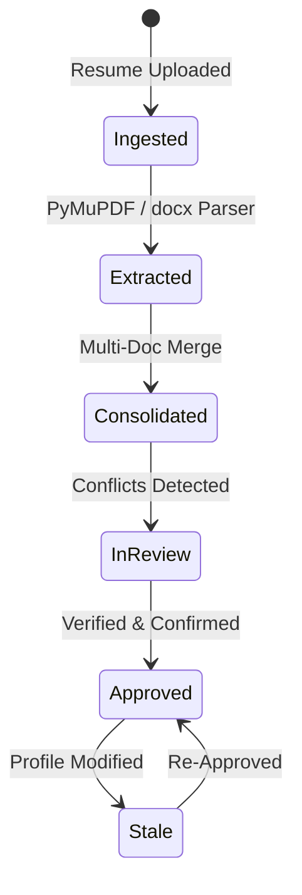
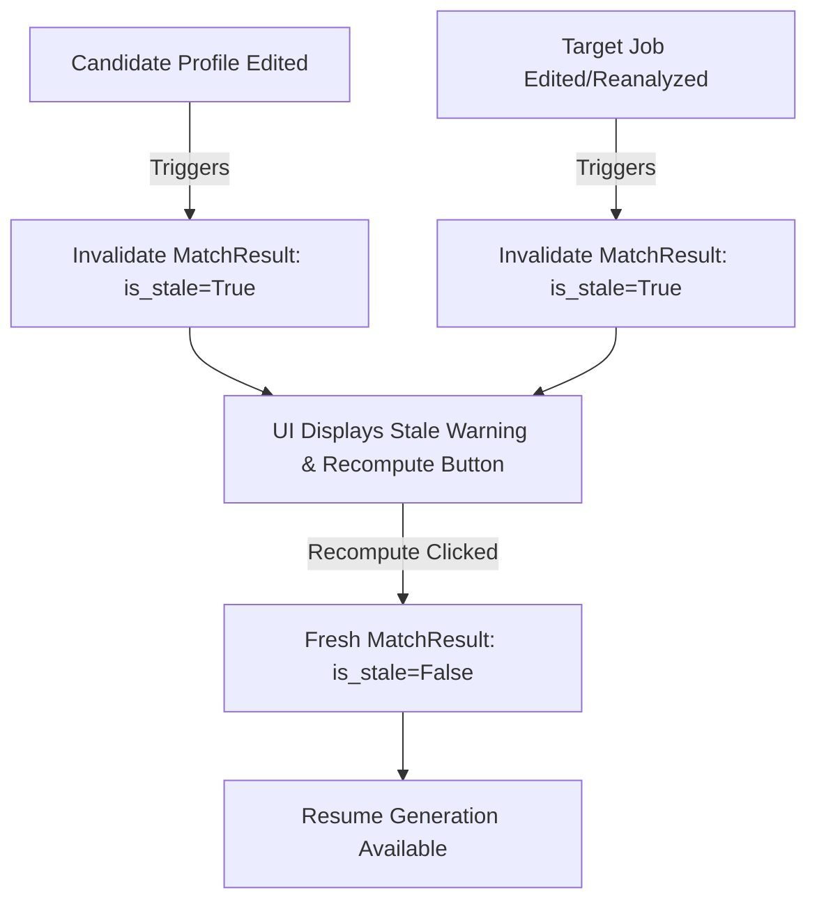
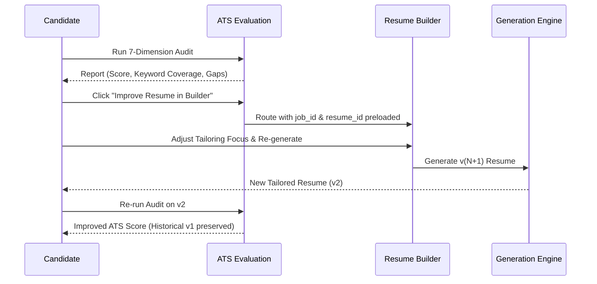

# Candidate Platform — Business Logic & State Rules
## AI Resume Intelligence Platform

---

## 1. Guiding Philosophy & Architectural Tenets

The business logic of the AI Resume Intelligence Platform is governed by four foundational tenets:

1. **Approved Candidate Profile is the Master Source of Truth**:
   Raw resume uploads are transient ingestion artifacts. Once information is extracted, consolidated, and verified by the candidate, the **Candidate Profile** becomes the single authoritative source for all downstream operations (Matching, Generation, ATS Evaluation).
2. **Strict Zero-Hallucination Policy**:
   No resume builder or AI assistant is permitted to invent employment history, fabricate skills, manufacture metrics, or synthesize credentials. Every bullet point and summary statement must have a verifiable provenance citation tracing back to the candidate's approved profile.
3. **Cross-Module Reactive Invalidation**:
   State mutations must cascade logically across dependent entities. Modifying an upstream entity (such as updating profile skills or editing job requirements) immediately invalidates downstream derived results (marking matches as stale) rather than silently presenting obsolete data.
4. **Historical Snapshot Preservation**:
   Modifying an approved profile or generating a new resume must never retroactively alter or rewrite historical records. Generated resumes and ATS reports remain immutable historical snapshots pinned to specific versions.

---

## 2. Entity Lifecycle & State Transitions



### 2.1 Candidate Profile States

- **`DRAFT` / `UNAPPROVED`**: Initial state after automated consolidation. Extracted facts are considered unconfirmed until the candidate inspects and validates them.
- **`APPROVED`**: Formal authoritative state. Requires:
  1. Complete contact details (Full legal name, valid email address).
  2. At least one verified work experience or academic credential.
  3. Zero unresolved blocking conflicts.
- **Reversion to Draft**: If an approved profile is edited (e.g. experience deleted, skill added, or headline updated), the approval timestamp is cleared, and downstream match results are marked stale.

---

## 3. Reactive Cross-Module Invalidation Rules

To ensure strict data integrity across the user journey, the platform implements four explicit cross-module invalidation rules:



### Rule 1: Candidate Profile Mutation
- **Trigger**: Any modification to candidate profile fields, adding/editing/deleting experiences, education, skills, certifications, or projects, or resolving conflicts.
- **Action**:
  ```python
  # app/api/profiles.py
  def _invalidate_profile_matches(db: Session, profile_id: str):
      db.query(MatchResult).filter(
          MatchResult.candidate_profile_id == profile_id,
          MatchResult.is_stale == False
      ).update({
          "is_stale": True,
          "stale_reason": "Candidate profile updated"
      })
  ```
- **Consequence**:
  - `MatchResult.is_stale` set to `True`.
  - `MatchResult.stale_reason` set to `"Candidate profile updated"`.
  - Frontend `Matching.tsx` displays an amber "Match Outdated" banner with a direct "Recompute Match" action button.
  - Resume Builder warns if the user attempts to generate a tailored resume against a stale match.

### Rule 2: Target Job Description Mutation
- **Trigger**: Updating job title, company, requirements, or re-running JD analysis on `/api/v1/jobs/{job_id}`.
- **Action**:
  ```python
  # app/api/jobs.py
  db.query(MatchResult).filter(
      MatchResult.job_id == job_id,
      MatchResult.is_stale == False
  ).update({
      "is_stale": True,
      "stale_reason": "Job description updated"
  })
  ```
- **Consequence**:
  - `MatchResult.is_stale` set to `True`.
  - `MatchResult.stale_reason` set to `"Job description updated"`.
  - Candidate is prompted to recompute match before generating tailored resumes.

### Rule 3: Resume Regeneration & Version Snapshotting
- **Trigger**: User generates a tailored resume via `POST /api/v1/resumes/generate`.
- **Action**:
  - Creates a new `GeneratedResume` database record with an incremented version number (`v1`, `v2`, etc.).
  - Freezes the exact profile data, job requirements, and match score at that point in time.
  - Writes distinct physical files: `storage/generated_resumes/{id}.pdf` and `{id}.docx`.
- **Consequence**:
  - Existing `AtsEvaluation` records remain permanently linked to their specific `resume_id`.
  - Prior versions are preserved in version history and can be visually diffed.

### Rule 4: Job Application Pipeline Binding
- **Trigger**: Creating or updating a job application via `POST /api/v1/applications`.
- **Action**:
  - Directly binds `job_id` and `resume_id`.
  - Persists company name, role title, applied date, salary range, and interview rounds.
- **Consequence**:
  - The application card in the Kanban board displays a direct link to the exact tailored resume version submitted.

---

## 4. Skill Match Engine Logic

The matching engine computes a deterministic alignment score across 6 weighted dimensions.

### 4.1 Scoring Dimensions & Formula

$$\text{Fit Score} = \sum_{i=1}^{6} (w_i \times S_i)$$

| Dimension | Weight ($w_i$) | Evaluation Method |
|---|---|---|
| **Mandatory Skills** | 35% | Direct keyword and semantic token match against profile skills, experiences, and project tags. |
| **Experience Alignment** | 25% | Cumulative years of relevant employment compared against required seniority and role scope. |
| **Domain Fit** | 15% | Industry terms, architectural concepts, and domain keywords present in past roles. |
| **Preferred Skills** | 10% | Secondary skills marked as "nice to have" or "preferred" in the job posting. |
| **Education Alignment** | 10% | Degree level (Bachelor's, Master's, PhD) and field of study match against JD prerequisites. |
| **Certifications** | 5% | Industry certifications (e.g. AWS Solutions Architect, PMP, CISA) required or preferred. |

### 4.2 Requirement Status Taxonomy

Every requirement extracted from the job description is classified into one of five statuses:
- **`MATCHED`**: Unambiguous evidence exists in the approved profile (direct skill name or clear bullet point citation).
- **`PARTIALLY_MATCHED`**: Candidate demonstrates related knowledge or adjacent technology (e.g., PostgreSQL vs MySQL, or GCP vs AWS).
- **`MISSING`**: No evidence found in approved profile.
- **`NEEDS_VERIFICATION`**: Keyword mentioned in raw resume text but unconfirmed in candidate profile.
- **`NOT_APPLICABLE`**: Organizational requirement not relevant to individual candidate evaluation.

### 4.3 Honest Gap Analysis Rules
- **No Hallucination Advice**: The platform will never suggest fabricating experience or inserting dishonest claims.
- **Actionable Remediation**:
  - For missing skills: Recommends highlighting adjacent frameworks or completing specific online certifications.
  - For experience gaps: Suggests emphasizing high-impact portfolio projects that demonstrate equivalent competence.

---

## 5. Single-Page A4 Resume Layout Business Rules

To guarantee strict compliance with corporate recruitment standards and international A4 formats, the generation engine enforces layout constraints:

1. **A4 Dimension Invariant**:
   - Page dimensions are fixed at $210 \times 297\text{ mm}$ ($595.28 \times 841.89\text{ pt}$).
   - Top and bottom margins: $36\text{ pt}$ ($0.5\text{ in}$).
   - Left and right margins: $36\text{ pt}$ ($0.5\text{ in}$).
   - Total printable vertical height: $769.89\text{ pt}$.
2. **Dynamic Spacing Clamping**:
   - The engine measures total content height before finalizing layout.
   - If content exceeds $769.89\text{ pt}$, vertical line spacing, paragraph padding, and bullet margins are iteratively compressed within readable ergonomic limits (down to a minimum of $8.5\text{ pt}$ font size and $1.5\text{ pt}$ paragraph spacing).
3. **Strict Page Assertion**:
   - In PDF rendering, `len(doc)` is asserted to be exactly 1.
   - If content cannot fit after clamping, lower-priority bullet points (those with lowest match relevance) are truncated with an advisory flag.

---

## 6. ATS Evaluation & Optimization Loop



### 6.1 The 7 Evaluation Dimensions
1. **Mandatory Skills**: Percentage of hard technical requirements present.
2. **Preferred Skills**: Percentage of secondary requirements covered.
3. **Experience Alignment**: Seniority, role title keywords, and tenure match.
4. **Education Alignment**: Credential level match.
5. **Keyword Density & Relevance**: Frequency and contextual placement of essential terms.
6. **Structure & Format Parsability**: Table formatting, standard headings, clear contact sections.
7. **Readability & Style**: Bullet point length, active verb usage, sentence complexity.

### 6.2 Anti-Stuffing Guard
- Calculates keyword frequency relative to total word count.
- If any single keyword exceeds 3.5% of total document text, an **Anti-Stuffing Alert** is generated warning that recruitment parsers may penalize repetitive text.

---

## 7. Dynamic Workflow Engine Logic

The dynamic workflow engine (`app/services/workflow_engine.py`) continuously computes candidate progress across all 12 stages and identifies the primary recommended action:

| Stage # | Stage Key | Condition for `COMPLETED` | Condition for `NEEDS_ATTENTION` / `IN_PROGRESS` | Fallback / Blocked Condition |
|---|---|---|---|---|
| **1** | `auth` | `user_id` authenticated. | Always `completed` when logged in. | N/A |
| **2** | `upload_resumes` | At least 1 `ResumeDocument` uploaded. | N/A | `not_started` |
| **3** | `extract_info` | At least 1 resume has `status == 'completed'`. | Resumes present but none completed (`status == 'pending'`). | `not_started` |
| **4** | `consolidate_profile` | At least 1 `CandidateProfile` exists. | Resumes completed but profile missing. | `blocked` (needs stage 3) |
| **5** | `resolve_conflicts` | Profile exists and zero unresolved conflicts. | Unresolved conflicts exist (`conflicts_count > 0`). | `not_started` |
| **6** | `approve_profile` | Profile exists and `is_approved == True`. | Profile exists but not approved. | `blocked` (if blocking conflicts) |
| **7** | `add_job` | At least 1 `JobDescription` exists. | N/A | `not_started` |
| **8** | `analyze_job` | At least 1 job with parsed requirements. | Jobs exist but analysis pending. | `blocked` (needs stage 7) |
| **9** | `match_candidate` | At least 1 `MatchResult` computed. | Matches exist but `is_stale == True`. | `not_started` / `blocked` |
| **10** | `gap_analysis` | Match result reviewed with gap insights. | Fit score < 70% with active gaps. | `not_started` |
| **11** | `generate_resume` | At least 1 `GeneratedResume` exists. | Generation in progress. | `blocked` (needs stage 9) |
| **12** | `ats_and_track` | At least 1 `AtsEvaluation` and `JobApplication`. | Evaluation done but no application tracked. | `not_started` |

### Primary Recommended Action Priority
The engine prioritizes actions by evaluating candidate progress from Stage 1 to 12. The earliest stage that is incomplete or requires attention becomes the candidate's **Primary Recommended Action**, featured prominently on the Dashboard.
