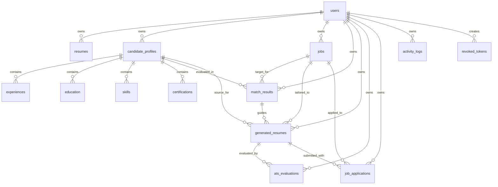

# Candidate Platform — Database Architecture
## AI Resume Intelligence Platform

---

## 1. Entity-Relationship Diagram (ERD)

---

## 2. Table Specifications & Schemas

### 2.1 Identity, Security & Auditing

#### `users`
Stores authenticated candidate credentials and profile settings.
| Column | Type | Constraints | Description |
|---|---|---|---|
| `id` | `VARCHAR(36)` | PRIMARY KEY | UUIDv4 identifier |
| `email` | `VARCHAR(255)` | UNIQUE, NOT NULL, INDEX | Candidate login email |
| `hashed_password` | `VARCHAR(255)` | NOT NULL | Argon2id / PBKDF2-SHA256 password hash |
| `full_name` | `VARCHAR(255)` | NOT NULL | Candidate legal full name |
| `is_active` | `BOOLEAN` | DEFAULT TRUE, NOT NULL | Account active status |
| `created_at` | `DATETIME` | DEFAULT UTC NOW, NOT NULL | Account creation timestamp |
| `updated_at` | `DATETIME` | DEFAULT UTC NOW, NOT NULL | Last update timestamp |

#### `revoked_tokens`
Maintains blacklisted JWT session tokens post-logout.
| Column | Type | Constraints | Description |
|---|---|---|---|
| `id` | `VARCHAR(36)` | PRIMARY KEY | UUIDv4 identifier |
| `token_jti` | `VARCHAR(255)` | UNIQUE, NOT NULL, INDEX | JWT Unique ID (`jti`) |
| `user_id` | `VARCHAR(36)` | FK -> `users.id` (CASCADE) | User who owned the session |
| `revoked_at` | `DATETIME` | DEFAULT UTC NOW, NOT NULL | Timestamp token was invalidated |
| `expires_at` | `DATETIME` | NOT NULL | Token expiration timestamp for cleanup |

#### `rate_limits`
In-memory or persistent store tracking sliding-window request timestamps for sensitive endpoints.
| Column | Type | Constraints | Description |
|---|---|---|---|
| `key` | `VARCHAR(255)` | PRIMARY KEY | IP address or composite `ip:endpoint` key |
| `window_start` | `DATETIME` | NOT NULL | Start timestamp of current rate limit window |
| `request_count` | `INTEGER` | DEFAULT 0, NOT NULL | Number of requests executed in window |

#### `activity_logs`
Immutable audit log recording candidate lifecycle actions.
| Column | Type | Constraints | Description |
|---|---|---|---|
| `id` | `VARCHAR(36)` | PRIMARY KEY | UUIDv4 identifier |
| `user_id` | `VARCHAR(36)` | FK -> `users.id` (CASCADE), INDEX | Candidate who performed action |
| `action` | `VARCHAR(100)` | NOT NULL, INDEX | Event type (`resume_uploaded`, `profile_approved`, etc.) |
| `title` | `VARCHAR(255)` | NOT NULL | Human-readable activity title |
| `description` | `TEXT` | NULLABLE | Detailed event explanation or metrics |
| `entity_type` | `VARCHAR(50)` | NULLABLE | Target entity type (`resume`, `job`, `match`, etc.) |
| `entity_id` | `VARCHAR(36)` | NULLABLE | Target entity UUID |
| `created_at` | `DATETIME` | DEFAULT UTC NOW, NOT NULL, INDEX | Event timestamp |

---

### 2.2 Resume Ingestion & Candidate Knowledge Base

#### `resumes`
Ingested raw candidate resumes.
| Column | Type | Constraints | Description |
|---|---|---|---|
| `id` | `VARCHAR(36)` | PRIMARY KEY | UUIDv4 identifier |
| `user_id` | `VARCHAR(36)` | FK -> `users.id` (CASCADE), INDEX | Owner user ID |
| `filename` | `VARCHAR(255)` | NOT NULL | Original uploaded filename |
| `file_path` | `VARCHAR(512)` | NOT NULL | Physical disk storage path |
| `file_size` | `INTEGER` | NOT NULL | File size in bytes |
| `content_type` | `VARCHAR(100)` | NOT NULL | MIME type (`application/pdf`, etc.) |
| `status` | `VARCHAR(50)` | DEFAULT 'pending', NOT NULL | Status: `pending`, `completed`, `failed` |
| `extracted_text` | `TEXT` | NULLABLE | Raw extracted text |
| `extracted_data` | `JSON` | NULLABLE | Structured parsed entities & sections |
| `page_count` | `INTEGER` | DEFAULT 1, NOT NULL | Total page count |
| `created_at` | `DATETIME` | DEFAULT UTC NOW, NOT NULL | Upload timestamp |
| `updated_at` | `DATETIME` | DEFAULT UTC NOW, NOT NULL | Last update timestamp |

#### `candidate_profiles`
Consolidated master career profile for candidate.
| Column | Type | Constraints | Description |
|---|---|---|---|
| `id` | `VARCHAR(36)` | PRIMARY KEY | UUIDv4 identifier |
| `user_id` | `VARCHAR(36)` | FK -> `users.id` (CASCADE), INDEX | Owner user ID |
| `full_name` | `VARCHAR(255)` | NOT NULL | Candidate legal name |
| `headline` | `VARCHAR(255)` | NULLABLE | Professional summary headline |
| `email` | `VARCHAR(255)` | NULLABLE | Contact email |
| `phone` | `VARCHAR(50)` | NULLABLE | Contact telephone |
| `location` | `VARCHAR(255)` | NULLABLE | City, State, Country |
| `summary` | `TEXT` | NULLABLE | Professional career narrative |
| `is_approved` | `BOOLEAN` | DEFAULT FALSE, NOT NULL | Authoritative approval flag |
| `approved_at` | `DATETIME` | NULLABLE | Timestamp candidate approved profile |
| `completeness_score` | `FLOAT` | DEFAULT 0.0, NOT NULL | Completeness percentage (0.0 to 100.0) |
| `conflicts` | `JSON` | DEFAULT '[]', NOT NULL | Detected cross-document data conflicts |
| `projects` | `JSON` | DEFAULT '[]', NOT NULL | Portfolio projects collection |
| `source_resume_ids`| `JSON` | DEFAULT '[]', NOT NULL | Array of resume UUIDs merged |
| `created_at` | `DATETIME` | DEFAULT UTC NOW, NOT NULL | Profile creation timestamp |
| `updated_at` | `DATETIME` | DEFAULT UTC NOW, NOT NULL | Last update timestamp |

#### `experiences`
Employment history records belonging to a candidate profile.
| Column | Type | Constraints | Description |
|---|---|---|---|
| `id` | `VARCHAR(36)` | PRIMARY KEY | UUIDv4 identifier |
| `candidate_profile_id` | `VARCHAR(36)` | FK -> `candidate_profiles.id` (CASCADE), INDEX | Parent profile ID |
| `job_title` | `VARCHAR(255)` | NOT NULL | Job title held |
| `company_name` | `VARCHAR(255)` | NOT NULL | Employer organization |
| `start_date` | `VARCHAR(50)` | NULLABLE | Start date string (YYYY-MM) |
| `end_date` | `VARCHAR(50)` | NULLABLE | End date string or 'Present' |
| `is_current` | `BOOLEAN` | DEFAULT FALSE, NOT NULL | Current role indicator |
| `location` | `VARCHAR(255)` | NULLABLE | Employment location |
| `description` | `TEXT` | NULLABLE | Role summary |
| `highlights` | `JSON` | DEFAULT '[]', NOT NULL | Bullet points of accomplishments |
| `skills_used` | `JSON` | DEFAULT '[]', NOT NULL | Technologies and skills applied |
| `verification_status` | `VARCHAR(50)` | DEFAULT 'extracted', NOT NULL | Status: `extracted`, `confirmed` |

#### `education`
Academic degrees and institutional qualifications.
| Column | Type | Constraints | Description |
|---|---|---|---|
| `id` | `VARCHAR(36)` | PRIMARY KEY | UUIDv4 identifier |
| `candidate_profile_id` | `VARCHAR(36)` | FK -> `candidate_profiles.id` (CASCADE), INDEX | Parent profile ID |
| `institution` | `VARCHAR(255)` | NOT NULL | University / College / School |
| `degree` | `VARCHAR(255)` | NOT NULL | Degree title (B.S., M.S., etc.) |
| `field_of_study` | `VARCHAR(255)` | NULLABLE | Major or specialization |
| `graduation_year` | `VARCHAR(50)` | NULLABLE | Graduation year or expected date |
| `gpa` | `VARCHAR(50)` | NULLABLE | Academic GPA / honors |

#### `skills`
Master technical and professional competencies.
| Column | Type | Constraints | Description |
|---|---|---|---|
| `id` | `VARCHAR(36)` | PRIMARY KEY | UUIDv4 identifier |
| `candidate_profile_id` | `VARCHAR(36)` | FK -> `candidate_profiles.id` (CASCADE), INDEX | Parent profile ID |
| `name` | `VARCHAR(100)` | NOT NULL | Normalized skill name |
| `category` | `VARCHAR(100)` | DEFAULT 'general', NOT NULL | Category (e.g. languages, frameworks) |
| `proficiency` | `VARCHAR(50)` | DEFAULT 'intermediate', NOT NULL | Level: `beginner`, `intermediate`, `expert` |
| `years_of_experience` | `FLOAT` | DEFAULT 1.0, NOT NULL | Estimated years experience |
| `is_verified` | `BOOLEAN` | DEFAULT FALSE, NOT NULL | Verified against experience evidence |

#### `certifications`
Professional licenses and industry credentials.
| Column | Type | Constraints | Description |
|---|---|---|---|
| `id` | `VARCHAR(36)` | PRIMARY KEY | UUIDv4 identifier |
| `candidate_profile_id` | `VARCHAR(36)` | FK -> `candidate_profiles.id` (CASCADE), INDEX | Parent profile ID |
| `name` | `VARCHAR(255)` | NOT NULL | Certification title |
| `issuing_organization`| `VARCHAR(255)` | NOT NULL | Authority (AWS, Cisco, Scrum Alliance) |
| `issue_date` | `VARCHAR(50)` | NULLABLE | Issue date (YYYY-MM) |
| `expiration_date` | `VARCHAR(50)` | NULLABLE | Expiry date (YYYY-MM) |
| `credential_id` | `VARCHAR(255)` | NULLABLE | Credential ID or verification code |
| `credential_url` | `VARCHAR(512)` | NULLABLE | Online verification link |

---

### 2.3 Job Descriptions & Matching Intelligence

#### `jobs`
Analyzed target job postings.
| Column | Type | Constraints | Description |
|---|---|---|---|
| `id` | `VARCHAR(36)` | PRIMARY KEY | UUIDv4 identifier |
| `user_id` | `VARCHAR(36)` | FK -> `users.id` (CASCADE), INDEX | Owner user ID |
| `title` | `VARCHAR(255)` | NOT NULL | Job title |
| `company` | `VARCHAR(255)` | NOT NULL | Hiring organization |
| `department` | `VARCHAR(255)` | NULLABLE | Business unit or team |
| `location` | `VARCHAR(255)` | NULLABLE | Work location |
| `work_arrangement` | `VARCHAR(50)` | DEFAULT 'unspecified', NOT NULL | `remote`, `hybrid`, `on_site` |
| `raw_text` | `TEXT` | NOT NULL | Unstructured job description text |
| `summary` | `TEXT` | NULLABLE | Summary overview of role |
| `mandatory_skills` | `JSON` | DEFAULT '[]', NOT NULL | Array of required skills |
| `preferred_skills` | `JSON` | DEFAULT '[]', NOT NULL | Array of nice-to-have skills |
| `responsibilities` | `JSON` | DEFAULT '[]', NOT NULL | Array of role responsibilities |
| `experience_years_min`| `FLOAT` | NULLABLE | Minimum years experience |
| `education_level` | `VARCHAR(100)` | NULLABLE | Required degree level |
| `eligibility_restrictions` | `JSON` | DEFAULT '[]', NOT NULL | Work authorization, clearance, etc. |
| `created_at` | `DATETIME` | DEFAULT UTC NOW, NOT NULL | Creation timestamp |
| `updated_at` | `DATETIME` | DEFAULT UTC NOW, NOT NULL | Last update timestamp |

#### `match_results`
Deterministic skill and experience match evaluation.
| Column | Type | Constraints | Description |
|---|---|---|---|
| `id` | `VARCHAR(36)` | PRIMARY KEY | UUIDv4 identifier |
| `user_id` | `VARCHAR(36)` | FK -> `users.id` (CASCADE), INDEX | Owner user ID |
| `candidate_profile_id` | `VARCHAR(36)` | FK -> `candidate_profiles.id` (CASCADE), INDEX | Evaluated profile |
| `job_id` | `VARCHAR(36)` | FK -> `jobs.id` (CASCADE), INDEX | Evaluated job |
| `overall_fit_score` | `FLOAT` | NOT NULL | Composite match score (0.0 to 100.0) |
| `dimension_scores` | `JSON` | NOT NULL | Breakdown across the 6 dimensions |
| `matched_skills` | `JSON` | DEFAULT '[]', NOT NULL | Matched skills and evidence citations |
| `missing_skills` | `JSON` | DEFAULT '[]', NOT NULL | Missing requirements |
| `gap_analysis` | `JSON` | DEFAULT '{}', NOT NULL | Recommendations and career advice |
| `is_stale` | `BOOLEAN` | DEFAULT FALSE, NOT NULL, INDEX | Reactive invalidation flag |
| `stale_reason` | `VARCHAR(255)` | NULLABLE | Reason flagged (`Profile updated`, etc.) |
| `created_at` | `DATETIME` | DEFAULT UTC NOW, NOT NULL | Match calculation timestamp |

---

### 2.4 Resume Generation, ATS Evaluation & Applications

#### `generated_resumes`
Tailored single-page resumes generated for specific jobs.
| Column | Type | Constraints | Description |
|---|---|---|---|
| `id` | `VARCHAR(36)` | PRIMARY KEY | UUIDv4 identifier |
| `user_id` | `VARCHAR(36)` | FK -> `users.id` (CASCADE), INDEX | Owner user ID |
| `candidate_profile_id` | `VARCHAR(36)` | FK -> `candidate_profiles.id` (CASCADE) | Source profile |
| `job_id` | `VARCHAR(36)` | FK -> `jobs.id` (CASCADE) | Target job |
| `title` | `VARCHAR(255)` | NOT NULL | Resume title |
| `version` | `INTEGER` | DEFAULT 1, NOT NULL | Version increment |
| `pdf_path` | `VARCHAR(512)` | NULLABLE | Path to compiled A4 PDF file |
| `docx_path` | `VARCHAR(512)` | NULLABLE | Path to compiled Word DOCX file |
| `ats_score` | `FLOAT` | DEFAULT 0.0, NOT NULL | Tailored ATS score |
| `structured_content` | `JSON` | NOT NULL | Full frozen resume sections & bullets |
| `claim_provenance` | `JSON` | DEFAULT '[]', NOT NULL | Exact audit trail linking bullets to profile |
| `created_at` | `DATETIME` | DEFAULT UTC NOW, NOT NULL | Generation timestamp |

#### `ats_evaluations`
Transparent 7-dimension ATS audit reports.
| Column | Type | Constraints | Description |
|---|---|---|---|
| `id` | `VARCHAR(36)` | PRIMARY KEY | UUIDv4 identifier |
| `user_id` | `VARCHAR(36)` | FK -> `users.id` (CASCADE), INDEX | Owner user ID |
| `resume_id` | `VARCHAR(36)` | FK -> `generated_resumes.id` (CASCADE), INDEX | Evaluated resume version |
| `job_id` | `VARCHAR(36)` | FK -> `jobs.id` (CASCADE), INDEX | Target job comparison |
| `overall_score` | `FLOAT` | NOT NULL | Composite ATS score (0.0 to 100.0) |
| `dimension_scores` | `JSON` | NOT NULL | Breakdown across 7 dimensions |
| `keyword_analysis` | `JSON` | NOT NULL | Keyword density & anti-stuffing check |
| `recommendations` | `JSON` | DEFAULT '[]', NOT NULL | Actionable improvement suggestions |
| `created_at` | `DATETIME` | DEFAULT UTC NOW, NOT NULL | Evaluation timestamp |

#### `job_applications`
Kanban pipeline application tracker.
| Column | Type | Constraints | Description |
|---|---|---|---|
| `id` | `VARCHAR(36)` | PRIMARY KEY | UUIDv4 identifier |
| `user_id` | `VARCHAR(36)` | FK -> `users.id` (CASCADE), INDEX | Owner user ID |
| `job_id` | `VARCHAR(36)` | FK -> `jobs.id` (SET NULL), NULLABLE | Associated job description |
| `resume_id` | `VARCHAR(36)` | FK -> `generated_resumes.id` (SET NULL), NULLABLE | Linked tailored resume version |
| `company_name` | `VARCHAR(255)` | NOT NULL | Employer organization |
| `role_title` | `VARCHAR(255)` | NOT NULL | Position applied for |
| `job_url` | `VARCHAR(512)` | NULLABLE | External job board or careers link |
| `status` | `VARCHAR(50)` | DEFAULT 'INTERESTED', NOT NULL, INDEX | Stage: `INTERESTED`, `PREPARING`, `APPLIED`, `ASSESSMENT`, `INTERVIEW`, `OFFER`, `REJECTED`, `WITHDRAWN` |
| `applied_date` | `VARCHAR(50)` | NULLABLE | Submission date string |
| `salary_range` | `VARCHAR(100)` | NULLABLE | Expected or offered compensation |
| `notes` | `TEXT` | NULLABLE | Candidate application notes |
| `interview_rounds` | `JSON` | DEFAULT '[]', NOT NULL | Multi-round interview log |
| `created_at` | `DATETIME` | DEFAULT UTC NOW, NOT NULL | Record creation timestamp |
| `updated_at` | `DATETIME` | DEFAULT UTC NOW, NOT NULL | Last update timestamp |

---

## 3. Data Integrity & Isolation Guarantees

1. **Multi-Tenant Isolation**:
   Every database query filters by `user_id == current_user.id`. Even if a malicious request attempts to access an arbitrary UUID via URL path manipulation, the query returns `404 Not Found`.
2. **Cascading Purge on Account Deletion**:
   When a user invokes `DELETE /api/v1/auth/me`, foreign keys configured with `ON DELETE CASCADE` guarantee that all associated resumes, candidate profiles, experiences, education, skills, jobs, matches, generated resumes, ATS reports, application records, and activity logs are permanently expunged in a single atomic transaction.
3. **Physical File Lifecycle Cleanup**:
   Deletions of `ResumeDocument` and `GeneratedResume` explicitly unlink physical `.pdf` and `.docx` files from the filesystem before committing the database transaction, preventing orphan files.
4. **SQLite WAL Mode**:
   SQLite is initialized with Write-Ahead Logging (`PRAGMA journal_mode=WAL`), allowing concurrent readers without blocking writes and providing crash resilience.
