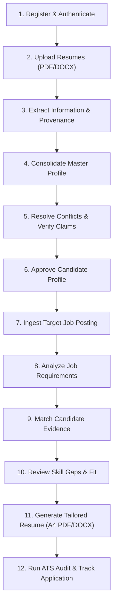

# Candidate Platform — Product Specification
## AI Resume Intelligence Platform

---

## 1. Product Vision & Executive Overview

The **AI Resume Intelligence Platform** is an open-source, self-hostable, candidate-first career intelligence engine. Designed for modern professionals navigating automated Applicant Tracking Systems (ATS) and competitive recruitment markets, the platform provides end-to-end tooling to extract, consolidate, verify, tailor, evaluate, and track career artifacts.

### 1.1 Core Value Propositions

1. **Approved Candidate Profile as Single Source of Truth**:
   Unlike generic AI resume tools that generate ungrounded prose or hallucinate credentials, every skill, bullet point, and experience metric is anchored in an authoritative candidate profile.
2. **Zero-Hallucination Tailoring**:
   Every claim synthesized in a tailored resume carries cryptographic/deterministic provenance tracing back to source documents, validated candidate claims, or specific portfolio projects.
3. **Guaranteed Single-Page A4 Output**:
   Algorithmic layout optimization guarantees standard A4 dimensions (210 x 297 mm / 595.28 x 841.89 pt) for both Microsoft Word (DOCX) and vector PDF outputs, preventing accidental multi-page spillovers.
4. **Transparent ATS Evaluation (Not a Hiring Lottery)**:
   Evaluates resumes across 7 deterministic dimensions with transparent scoring, keyword density checks, anti-stuffing alerts, and direct improvement loops.
5. **Dynamic 12-Stage Candidate Lifecycle**:
   Provides an intelligent state engine that evaluates candidate readiness, identifies missing prerequisites or stale data, and recommends actionable next steps.
6. **Self-Hostable & Privacy-First**:
   Full multi-tenant database isolation, sliding-window rate limiting, Argon2id/PBKDF2 security, and one-click JSON export for complete data portability.

---

## 2. Target User Personas

| Persona | Needs & Goals | Platform Solution |
|---|---|---|
| **Senior Software Engineer** | Manages 10+ years of diverse experience across legacy systems, cloud architectures, and open-source contributions. Needs role-specific resumes without manual rewrites. | Multi-resume ingestion consolidates historical versions into a master knowledge base; tailored resumes highlight relevant tech stacks while keeping length to 1 page. |
| **Career Switcher / Transitioning Pro** | Transitioning into AI/ML or Product Management. Has transferable skills but struggles to match domain keywords without misrepresentation. | Transparent skill match engine identifies genuine transferable evidence, highlights skill gaps, and recommends honest repositioning without hallucination. |
| **Active Job Applicant** | Submitting 20+ applications per month. Needs to track application statuses, customized resume versions, and interview rounds in one place. | Integrated 8-stage Kanban board linking target job descriptions, specific generated resume versions, external links, and interview round notes. |

---

## 3. The 12-Step Candidate Lifecycle

### Lifecycle Stage Specifications

| Stage # | Stage Name | Prerequisites | Operations | Artifacts / DB Outputs |
|---|---|---|---|---|
| **Stage 1** | Account Registration & Login | None | Email/password sign-up, session initiation, JWT issuance. | `User` record, Bearer token. |
| **Stage 2** | Resume Ingestion | Authenticated session | Multi-file upload (1-10 files), MIME validation, magic byte verification. | `ResumeDocument` records, disk storage in `storage/uploads/`. |
| **Stage 3** | Text & Structure Extraction | Stored resume file | Document-order block extraction (python-docx) or C-level text layout extraction (PyMuPDF). | Extracted text blocks, entity metadata, section headings. |
| **Stage 4** | Profile Consolidation | Extracted resumes | Multi-source deduplication, entity merging, normalization. | Initial `CandidateProfile` draft. |
| **Stage 5** | Conflict Resolution & Verification | Profile draft | Chronology overlap checks, discrepancy review, manual edits. | Resolved conflicts, verified item status. |
| **Stage 6** | Profile Approval | Zero unresolved critical conflicts | Mandatory contact & experience check, formal candidate approval. | `CandidateProfile.is_approved = True`, approval timestamp. |
| **Stage 7** | Target Job Ingestion | Approved profile (recommended) | Paste text or upload JD (`.pdf`, `.docx`, `.txt`, `.md`). | `JobDescription` record, storage in `storage/jobs/`. |
| **Stage 8** | Job Requirements Analysis | Stored job description | Mandatory vs preferred classification, eligibility constraints, seniority scoring. | Structured requirements, normalized tech stack. |
| **Stage 9** | Skill & Evidence Matching | Approved profile + Analyzed JD | 6-dimension deterministic alignment, citation extraction. | `MatchResult` record (scores, evidence links). |
| **Stage 10** | Gap Analysis & Remediation | Match result | Identification of missing criteria, honest positioning guidance. | Actionable remediation advice without fabrication. |
| **Stage 11** | Tailored Resume Generation | Approved profile + Match result | Algorithmic prioritization, dynamic A4 single-page spacing clamp. | `GeneratedResume` record, vector PDF & DOCX in `storage/generated_resumes/`. |
| **Stage 12** | ATS Audit & Application Tracking | Generated resume + Job | 7-dimension ATS audit, 8-stage Kanban pipeline tracking. | `AtsEvaluation` record, `JobApplication` record. |

---

## 4. Module Specifications

### Module 1: Dashboard & Lifecycle Engine
- **Header & Profile Gauge**: Displays candidate name, current professional headline, verification status, and profile completeness percentage.
- **Workflow Progress Tracker**: Visual 12-stage stepper reporting current status for each stage (`completed`, `in_progress`, `needs_attention`, `not_started`, `blocked`).
- **Dynamic Action Recommendation**: Backend-driven recommendation engine evaluates candidate database state to surface the single most impactful next action with title, description, priority, and deep link.
- **Activity Feed**: Immutable audit log displaying chronological events (`resume_uploaded`, `profile_approved`, `job_analyzed`, `match_generated`, `resume_generated`, `ats_evaluated`, `application_created`).
- **Pipeline Snapshots**: High-level metrics for resumes, profile items, target jobs, average match score, and active applications.

### Module 2: Resume Ingestion & Processing
- **File Ingestion**: Supports `.pdf` and `.docx` up to 10 MB.
- **Security Validation**: Magic byte signature verification, filename sanitization with UUID prefixes, strict MIME type matching.
- **Dual-Panel Modal**: Left panel shows raw text extracted from document; right panel displays extraction confidence, warnings (e.g. image-only pages, tables), and detected sections.
- **Reprocessing**: Ability to re-parse original stored files when parser engines are updated.
- **Multi-Document Selection**: Checkbox selection allowing multi-resume batch consolidation into a single candidate profile.

### Module 3: Candidate Profile Intelligence
- **Master Knowledge Base**: Structured repository of Personal Information, Experiences, Education, Technical Skills, Certifications, and Portfolio Projects.
- **Cross-Document Deduplication**: Normalizes identical company names, degrees, and skills from multiple resumes.
- **Conflict Management Engine**: Identifies overlapping dates, contradictory job titles, or disparate contact info. Allows side-by-side selection of Source A, Source B, or custom edit.
- **Item Verification Flags**: Each credential tracks provenance (`extracted`, `candidate_confirmed`, `project_evidenced`).
- **Approval Workflow**: Candidates must formally approve their profile. Modifying an approved profile marks it as draft and sets downstream match results to stale.

### Module 4: Job Description Intelligence
- **Ingestion Channels**: Multi-format document upload (`.pdf`, `.docx`, `.txt`, `.md`) or raw text paste.
- **Extraction Dimensions**:
  - Title, company, department, location, work arrangement (remote, hybrid, on-site).
  - Mandatory hard skills vs preferred/nice-to-have skills.
  - Required years of experience and education level.
  - Core role responsibilities and scope.
  - Eligibility restrictions (citizenship, clearance, geography).
- **Stale Invalidation Trigger**: Editing or reanalyzing job details automatically flags existing downstream matches as stale.

### Module 5: Evidence-Based Skill Matching Engine
- **Evaluation Dimensions**:
  1. Mandatory Skills (35% weight)
  2. Experience Alignment (25% weight)
  3. Domain Fit (15% weight)
  4. Preferred Skills (10% weight)
  5. Education Alignment (10% weight)
  6. Certifications (5% weight)
- **Status Classification**: Each job requirement is tagged `MATCHED`, `PARTIALLY_MATCHED`, `MISSING`, `NEEDS_VERIFICATION`, or `NOT_APPLICABLE`.
- **Evidence Citations**: Every match displays exact evidence strings extracted from candidate experience or projects.
- **Ethical Gap Analysis**: Clear recommendations for addressing missing skills without encouraging dishonest resume stuffing.
- **Stale State Handling**: Flags matches when upstream profile or job has mutated, offering a 1-click recompute action.

### Module 6: Resume Builder & Generation Engine
- **Layout Architecture**: Strict standard A4 dimensions (595.28 x 841.89 pt).
- **Dynamic Vertical Spacing Optimizer**: Computes total content height and dynamically clamps paragraph spacing, bullet margins, and font scales to ensure 100% single-page compliance.
- **Dual Output Formats**:
  - Clean vector PDF rendered via PyMuPDF.
  - Native Microsoft Word (.docx) styled with custom tables and typography.
- **Provenance Inspector**: Displays interactive citations for every bullet point and summary statement, linking each claim to its profile origin.
- **Version Management**: Preserves immutable snapshots across edits, enabling historical diffs and ATS score comparisons.

### Module 7: Transparent ATS Evaluation
- **7 Evaluation Dimensions**:
  1. Mandatory Skills Match
  2. Preferred Skills Coverage
  3. Experience Alignment
  4. Education Alignment
  5. Keyword Relevance & Density
  6. Structure & Format Parsability
  7. Readability & Sentence Complexity
- **Anti-Stuffing Detection**: Warns if keywords appear unnatural or excessively repeated.
- **Optimization Feedback Loop**: Direct "Improve Resume in Builder" action transfers ATS suggestions back into Resume Builder with target job and resume preloaded.

### Module 8: Job Application Tracker (Kanban)
- **8 Pipeline Stages**:
  - `INTERESTED`: Target jobs identified.
  - `PREPARING`: Custom resume being tailored.
  - `APPLIED`: Application submitted.
  - `ASSESSMENT`: Technical test or take-home assignment.
  - `INTERVIEW`: Scheduled screening or team interviews.
  - `OFFER`: Offer letter received.
  - `REJECTED`: Application declined.
  - `WITHDRAWN`: Candidate withdrew application.
- **Artifact Linking**: Directly links the specific `JobDescription` and `GeneratedResume` version used for the application.
- **Interview Tracker**: Multi-round interview log tracking dates, interviewer names, rounds (Screening, Technical, Behavioral, Exec), notes, and outcomes.

### Module 9: Settings, Security & Data Governance
- **Profile Management**: Update legal name, contact email, and preferences.
- **Security Controls**: Password change, rate-limited login defense.
- **Data Portability**: Full JSON career knowledge base export (`/api/v1/auth/export-data`) containing user info, resumes, profile items, jobs, matches, tailored resumes, application history, and activity logs.
- **Account Deletion**: Complete cascade deletion purging all database records and storage files from disk.

---

## 5. Non-Functional Specifications

### 5.1 Document Formatting & Page Limits
- **Page Size**: ISO 216 A4 (210 x 297 mm, 595.28 x 841.89 points).
- **Page Count**: Exactly 1 page. The generator asserts `len(doc) == 1` for PDF outputs.
- **Typography**: Professional font stack (Calibri/Arial in DOCX, Helvetica in PDF).
- **Margins**: Top/Bottom 36 pt (0.5 in), Left/Right 36 pt (0.5 in).

### 5.2 Security & Tenant Isolation
- **Authentication**: JWT Bearer tokens with HMAC-SHA256 signature and PBKDF2-SHA256 / Argon2id password hashing.
- **Authorization**: Tenant isolation enforced at the database query level (`WHERE user_id = current_user.id`).
- **File Storage**: Uploaded and generated files stored outside public web roots with randomized alphanumeric filenames.
- **Rate Limiting**: In-memory sliding-window limiter on sensitive endpoints (5 login attempts/minute).
- **HTTP Security Headers**: `X-Content-Type-Options: nosniff`, `X-Frame-Options: DENY`, `Referrer-Policy: strict-origin-when-cross-origin`.

### 5.3 Performance & Reliability
- **Resume Text Extraction**: < 500 ms for 2-page PDF/DOCX.
- **Skill Match Computation**: < 200 ms for typical 30-requirement job description.
- **Document Generation**: < 1.5 seconds for complete A4 PDF and DOCX compilation.
- **Database**: SQLite default with WAL mode enabled; zero external broker dependencies required for core operations.
