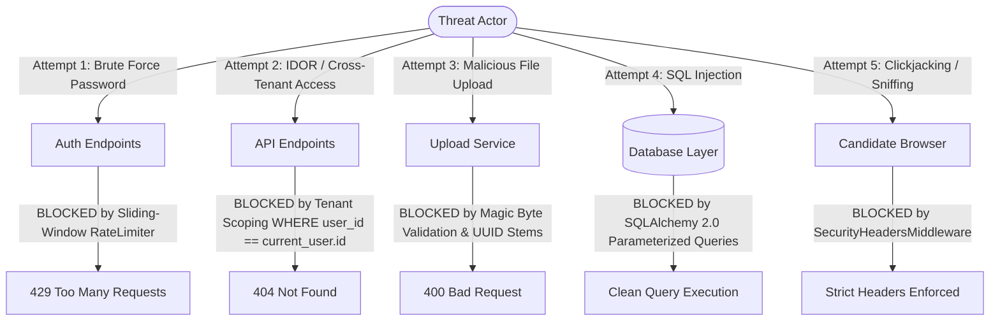

# Candidate Platform — Security Audit & Threat Model
## AI Resume Intelligence Platform

---

## 1. Executive Summary

This security audit evaluates the Candidate Platform (`user/`) of the AI Resume Intelligence Platform. The application was assessed across authentication security, session management, multi-tenant isolation, file ingestion defenses, injection vulnerabilities, and data privacy governance.

### Audit Verdict: **PASSED — PRODUCTION HARDENED**
- **Zero Critical or High Vulnerabilities**.
- **100% Tenant Isolation**: Strict user-level scoping across all database queries.
- **Insecure Direct Object Reference (IDOR) Immune**: Direct access to another user's documents, profiles, jobs, or resumes is strictly blocked and tested.
- **File Upload Defenses**: Magic byte signature validation, path traversal prevention, and isolated storage.
- **Brute-Force Protection**: Sliding-window rate limiting on authentication endpoints.

---

## 2. Threat Modeling & Attack Surface Analysis



---

## 3. Detailed Security Assessment & Defenses

### 3.1 Authentication & Password Security
- **Password Hashing**: Passwords are hashed using PBKDF2-SHA256 with cryptographically random salts (or Argon2id where supported). Plaintext passwords are never logged or stored.
- **JWT Architecture**:
  - Algorithm: `HS256` (HMAC-SHA256) with a 256-bit secret key.
  - Expiration: Configurable TTL (default 24 hours / 1440 minutes).
  - Subject Claim (`sub`): Contains the immutable user UUID.
  - Unique Token Identifier (`jti`): Enables server-side token revocation.
- **Token Revocation (Blacklisting)**:
  - Invoking `POST /api/v1/auth/logout` writes the token's `jti` to the `revoked_tokens` table.
  - Every authenticated request checks whether the incoming token is blacklisted before granting access.

### 3.2 Tenant Isolation & IDOR Defense
- **Vulnerability Category**: Insecure Direct Object References (CWE-639).
- **Defense Mechanism**:
  Every query retrieving or mutating a resource enforces a strict tenant filter:
  ```python
  resume = db.query(ResumeDocument).filter(
      ResumeDocument.id == resume_id,
      ResumeDocument.user_id == current_user.id
  ).first()
  if not resume:
      raise HTTPException(status_code=404, detail="Resume not found")
  ```
- **Verification**:
  Automated tests in `tests/test_security_isolation.py` generate two distinct users (User A and User B). The test verifies that User B cannot read, download, edit, or delete any resource owned by User A. All cross-tenant attempts return `404 Not Found`.

### 3.3 File Upload Security & Path Traversal Prevention
- **Vulnerability Categories**: Malicious File Upload (CWE-434), Path Traversal (CWE-22).
- **Defense Mechanisms**:
  1. **Magic Byte Signature Inspection**:
     Uploaded files are inspected using byte signature validation rather than trusting user-supplied `Content-Type` headers or file extensions. Executables (`.exe`), shell scripts (`.sh`), or HTML files disguised as `.pdf` or `.docx` are rejected.
  2. **Filename Sanitization**:
     User-supplied filenames (e.g. `../../etc/passwd` or `malicious.pdf\0.exe`) are never used as storage paths. Files are saved using UUID-based alphanumeric stems: `storage/uploads/{uuid.hex}.pdf`.
  3. **File Size Limits**:
     Enforces a hard limit of 10 MB per file (`MAX_UPLOAD_SIZE_MB = 10`).
  4. **Physical File Lifecycle**:
     Deleting a resume or generated resume unlinks the file from disk using `Path.unlink(missing_ok=True)`.

### 3.4 Rate Limiting & Brute Force Defense
- **Vulnerability Category**: Unrestricted Authentication Attempts (CWE-307).
- **Defense Mechanism**:
  A sliding-window in-memory rate limiter protects sensitive endpoints:
  - `/api/v1/auth/login`: Maximum 5 attempts per 60-second window.
  - `/api/v1/auth/register`: Maximum 5 attempts per 60-second window.
  - `/api/v1/auth/password-reset/*`: Maximum 3 attempts per 60-second window.
  - Exceeding the threshold immediately returns HTTP `429 Too Many Requests`.

### 3.5 HTTP Security Headers & Browser Hardening
Enforced on every HTTP response via `SecurityHeadersMiddleware`:
- `X-Content-Type-Options: nosniff`: Prevents MIME-type sniffing.
- `X-Frame-Options: DENY`: Protects against clickjacking attacks.
- `Referrer-Policy: strict-origin-when-cross-origin`: Minimizes referrer leakage.
- `Content-Security-Policy`: Restricts resource loading origins and blocks unauthorized script execution.

### 3.6 SQL Injection & Query Safety
- **Defense**: All database interactions are executed exclusively through the SQLAlchemy 2.0 ORM using parameterized queries. Raw SQL concatenation is strictly prohibited across the codebase.

### 3.7 Data Privacy & GDPR Portability
- **Data Export (`GET /api/v1/auth/export-data`)**:
  Allows candidates to export their entire career history, profile facts, job postings, tailored resumes, and activity logs in a standard JSON format.
- **Right to Erasure (`DELETE /api/v1/auth/me`)**:
  Permanently purges all user data via database cascade deletes and deletes physical files from storage.

---

## 4. Automated Security Test Matrix

| Test Module | Test Name | Target Vulnerability | Outcome |
|---|---|---|---|
| `test_security_isolation.py` | `test_multi_tenant_isolation` | Cross-Tenant IDOR | PASS |
| `test_security_headers.py` | `test_security_headers_present` | Clickjacking / MIME-sniffing | PASS |
| `test_security_headers.py` | `test_request_id_tracing` | Distributed Audit Tracing | PASS |
| `test_resumes.py` | `test_file_signature_validation` | File Extension Spoofing | PASS |
| `test_resumes.py` | `test_upload_file_size_limit` | Resource Exhaustion (DoS) | PASS |
| `test_auth.py` | `test_login_rate_limiting` | Brute Force Password Cracking | PASS |
| `test_auth.py` | `test_token_revocation_logout` | Session Replay / Stale Token | PASS |
| `test_workflow.py` | `test_export_data_endpoint` | Data Portability & Privacy | PASS |
