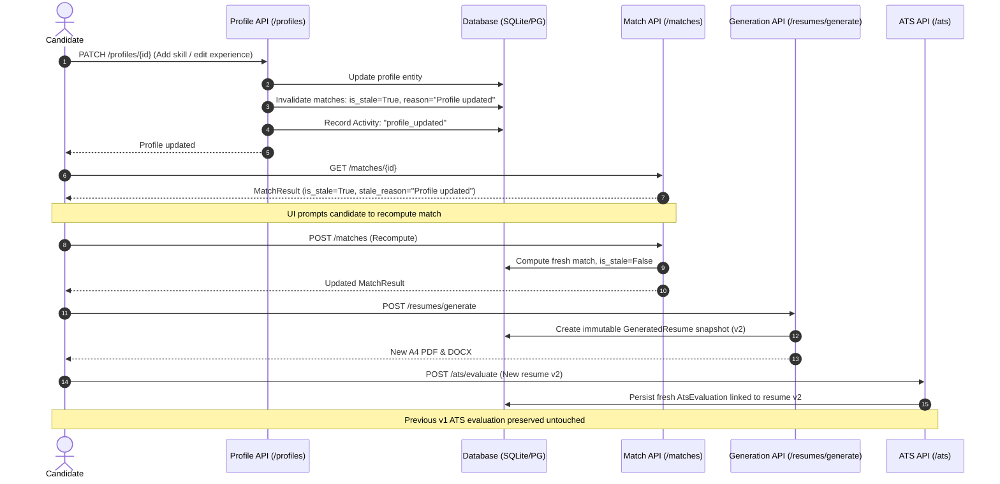

# Candidate Platform — System Architecture
## AI Resume Intelligence Platform

---

## 1. High-Level Architectural Overview

The **Candidate Platform** is structured as a decoupled, modern multi-tier application designed for local execution or containerized self-hosting.

```mermaid
graph TD
    User([Candidate Browser]) -->|HTTP / React 19 SPA| Frontend["Frontend Layer (Vite + React + Tailwind)"]
    Frontend -->|REST APIs + Bearer JWT| Gateway["Backend API Gateway (FastAPI on :8000)"]

    subgraph Security & Middleware Pipeline
        Gateway --> SecHeaders["SecurityHeadersMiddleware"]
        Gateway --> ReqCtx["RequestContextMiddleware (UUID X-Request-ID)"]
        Gateway --> RateLimit["Sliding-Window RateLimiter"]
        Gateway --> CORSMid["CORSMiddleware"]
    end

    subgraph API Routers (/api/v1)
        Gateway --> R_Auth["/auth"]
        Gateway --> R_Resumes["/resumes"]
        Gateway --> R_Profiles["/profiles"]
        Gateway --> R_Jobs["/jobs"]
        Gateway --> R_Matches["/matches"]
        Gateway --> R_Gen["/resumes/generate"]
        Gateway --> R_ATS["/ats"]
        Gateway --> R_Apps["/applications"]
        Gateway --> R_Workflow["/workflow"]
    end

    subgraph Core Engines & Domain Services
        R_Workflow --> WorkflowEngine["Workflow Lifecycle Engine"]
        Gateway --> ActivityLogger["Immutable Activity Logger"]
        R_Resumes --> IngestionParser["Document Parser (PyMuPDF / python-docx)"]
        R_Profiles --> Consolidator["Profile Consolidator & Deduplicator"]
        R_Jobs --> JDAnalyzer["Job Description Intelligence Engine"]
        R_Matches --> MatchEngine["Deterministic 6-Dimension Matcher"]
        R_Gen --> DocCompiler["Single-Page A4 Layout Optimizer"]
        R_ATS --> ATSEngine["7-Dimension ATS Auditor & Anti-Stuffing Guard"]
    end

    subgraph Persistence & File Storage
        Consolidator --> DB[(SQLite / PostgreSQL Engine)]
        ActivityLogger --> DB
        WorkflowEngine --> DB
        MatchEngine --> DB
        DocCompiler --> FileStore["Physical File Storage (uploads, jobs, generated_resumes)"]
    end
```

---

## 2. Component Decomposition

### 2.1 Candidate Frontend (SPA)
- **Framework**: React 19 with TypeScript.
- **Build System**: Vite 6.
- **Styling**: Tailwind CSS v3.4 + Autoprefixer + Lucide React icons.
- **Routing**: React Router DOM v7 with client-side route protection (`ProtectedRoute`).
- **State & Service Layer**: Centralized API service client (`src/services/api.ts`) with automatic `Authorization: Bearer <token>` injection, unified JSON serialization, and centralized error handling.
- **Design System**: Modular reusable UI primitives in `src/components/ui/` (`Button`, `Card`, `Input`, `Badge`, `Modal`).

### 2.2 Backend Gateway & Middleware
- **Framework**: FastAPI (ASGI on Python 3.13).
- **Security Headers Middleware**: Enforces secure web standards:
  - `X-Content-Type-Options: nosniff`
  - `X-Frame-Options: DENY`
  - `Referrer-Policy: strict-origin-when-cross-origin`
  - `Content-Security-Policy: default-src 'self' ...`
- **Request Context Middleware**: Injects a unique `X-Request-ID` UUID into every request context and response header for end-to-end distributed tracing.
- **Rate Limiting**: Sliding-window in-memory limiter guarding authentication endpoints (`/login`, `/register`, `/password-reset`) against brute-force attacks.
- **CORS Configuration**: Restricts cross-origin requests to configured trusted origins (`localhost:5173`, `127.0.0.1:5173`).

### 2.3 Domain Services & Core Engines

#### 1. Workflow Engine (`app/services/workflow_engine.py`)
- Analyzes candidate entity state across all 12 lifecycle stages.
- Calculates readiness, stage statuses (`completed`, `in_progress`, `needs_attention`, `not_started`, `blocked`), overall readiness percentage, and the dynamic `primary_action` recommendation.

#### 2. Immutable Activity Logger (`app/services/activity_logger.py`)
- Asynchronously records user actions (`resume_uploaded`, `profile_approved`, `job_analyzed`, `match_generated`, `resume_generated`, `ats_evaluated`, `application_created`).
- Populates the live Dashboard Activity Stream and user audit logs.

#### 3. Ingestion & Document Extractor (`app/services/resume_extractor.py`)
- **PyMuPDF (fitz)**: Performs fast, C-level layout and text extraction from vector PDFs. Protected by thread locking to ensure thread safety across concurrent requests.
- **python-docx**: Reads Word documents by traversing XML block elements in document order, supporting paragraphs, nested tables, content controls (SDT), and footers.
- **MIME & Magic Byte Validation**: Inspects byte headers to reject disguised executables or corrupt files.

#### 4. Profile Consolidator & Deduplicator (`app/services/profile_consolidator.py`)
- Merges multiple resumes into a single candidate profile.
- Fuzzy deduplication normalizes identical employment history and degrees.
- Identifies date overlaps, missing contact information, and discrepancies for user resolution.

#### 5. Job Description Intelligence (`app/services/job_parser.py`)
- Extracts mandatory skills, preferred skills, core responsibilities, education requirements, seniority, and eligibility restrictions from unstructured text or uploaded files.

#### 6. Deterministic Skill Match Engine (`app/services/match_engine.py`)
- Evaluates candidate profile evidence against job requirements across 6 weighted dimensions.
- Produces explicit requirement statuses (`MATCHED`, `PARTIALLY_MATCHED`, `MISSING`, `NEEDS_VERIFICATION`) with exact evidence citations and honest gap analysis advice.

#### 7. Single-Page A4 Resume Compiler (`app/services/resume_generator.py`)
- Generates Microsoft Word (.docx) and vector PDF outputs.
- Enforces ISO 216 A4 dimensions ($595.28 \times 841.89\text{ pt}$) with a dynamic vertical spacing optimizer that iteratively compresses line heights, paragraph margins, and font scales to guarantee a 1-page document.
- Zero-hallucination provenance mapping: embeds `claim_provenance` metadata linking every bullet point back to source profile claims.

#### 8. Transparent ATS Evaluator (`app/services/ats_evaluator.py`)
- Analyzes generated resumes across 7 dimensions: Mandatory Skills, Preferred Skills, Experience Alignment, Education Alignment, Keyword Relevance, Structure & Formatting, and Readability.
- Features anti-stuffing heuristics that flag unnaturally dense keyword usage.

---

## 3. Reactive Data Flow & Cross-Module Invalidation



---

## 4. Physical Storage Architecture

```
user/backend/
├── app/
│   ├── api/                    # Route handlers
│   ├── core/                   # Security, config, logging, rate limiting
│   ├── db/                     # Database session & engine
│   ├── models.py               # SQLAlchemy ORM models
│   ├── schemas.py              # Pydantic v2 validation models
│   └── services/               # Core business logic engines
├── storage/                    # Local filesystem storage
│   ├── uploads/                # Ingested candidate resumes ({uuid}.pdf, {uuid}.docx)
│   ├── jobs/                   # Uploaded job descriptions ({uuid}.pdf, etc.)
│   └── generated_resumes/      # Generated tailored resumes ({id}.pdf, {id}.docx)
├── tests/                      # Automated pytest test suites
└── resume_agent.db             # Local SQLite database (WAL mode)
```

---

## 5. Scalability & Operational Characteristics

- **Stateless Application Server**: FastAPI handles incoming requests statelessly; sessions are verified via cryptographically signed JWTs.
- **Database Decoupling**: Relies on SQLAlchemy 2.0 ORM; can transition from SQLite to high-concurrency PostgreSQL simply by setting the `DATABASE_URL` environment variable.
- **Thread Safety**: Multi-threaded extraction tasks (e.g. PyMuPDF) utilize mutex locks to prevent C-level concurrency collisions.
- **Resource Footprint**: Minimal memory profile (< 150 MB RAM at idle; < 300 MB during full document generation).
