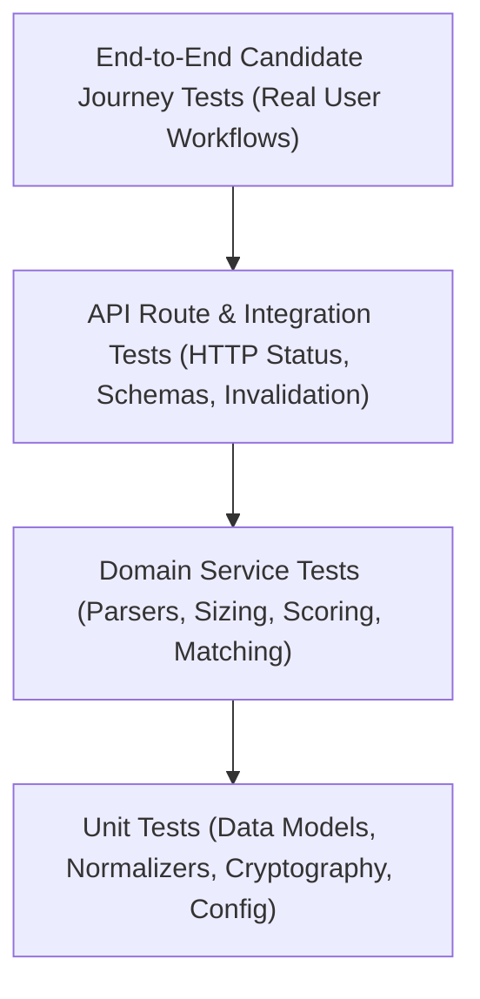

# Candidate Platform — Testing Strategy & Quality Assurance
## AI Resume Intelligence Platform

---

## 1. Testing Philosophy & Test Pyramid

The testing strategy of the Candidate Platform enforces strict quality gates across every layer of the architecture:



- **Unit & Domain Service Tests**: Test deterministic scoring algorithms, vertical spacing clamping for single-page A4 output, magic byte validators, and token hashing in isolation.
- **API & Integration Tests**: Verify FastAPI endpoint contracts, Pydantic v2 schema serialization, database transactions, foreign key cascades, and cross-module stale state invalidation.
- **End-to-End Candidate Journey Tests**: Execute the complete 12-stage candidate lifecycle within a single automated test run to ensure seamless cross-module workflows.
- **Zero Mock Data Policy**: Every user-facing UI component communicates directly with live backend endpoints. No simulated in-memory UI stubs exist.

---

## 2. Test Suite Health & Coverage Matrix

**Current Automated Suite**: **18 Test Modules, 104 Passing Tests, 0 Failures**  
**Execution Runtime**: ~17.9 seconds across all modules.

| Test Module | Test Focus | Total Tests | Status |
|---|---|---|---|
| `tests/test_candidate_e2e_journey.py` | Full 12-stage candidate journey simulation | 1 | PASS |
| `tests/test_workflow.py` | Workflow engine, activity feed, stale match invalidation, data export | 5 | PASS |
| `tests/test_resumes.py` | Multi-format upload, magic bytes, reprocess, text preview, delete | 20 | PASS |
| `tests/test_resume_quality.py` | A4 dimensions, single-page assertion, typography, margins | 8 | PASS |
| `tests/test_profiles.py` | Consolidation, conflict resolution, item CRUD, approval workflow | 8 | PASS |
| `tests/test_jobs.py` | Text parsing, JD upload, requirement extraction, patch update | 12 | PASS |
| `tests/test_matches.py` | 6-dimension fit formula, evidence citations, gap analysis | 9 | PASS |
| `tests/test_matching_integration.py`| Cross-module profile-to-job matching integration | 1 | PASS |
| `tests/test_generation.py` | Resume tailoring, DOCX & PDF generation, provenance tracking | 7 | PASS |
| `tests/test_ats.py` | 7-dimension ATS scoring, keyword stuffing detection, suggestions | 3 | PASS |
| `tests/test_applications.py` | 8-stage Kanban pipeline, resume linking, interview tracker | 3 | PASS |
| `tests/test_auth.py` | Registration, login, rate limiting, password reset, token blacklist | 4 | PASS |
| `tests/test_security_isolation.py` | Multi-tenant isolation and cross-tenant IDOR defense | 1 | PASS |
| `tests/test_security_headers.py` | HTTP security headers, request ID injection | 5 | PASS |
| `tests/test_database.py` | SQLAlchemy connection pooling, foreign keys, transactions | 4 | PASS |
| `tests/test_config.py` | Environment variable overrides, default path configurations | 6 | PASS |
| `tests/test_errors.py` | Centralized exception handling and 404/422 responses | 4 | PASS |
| `tests/test_health.py` | API health check and readiness endpoints | 3 | PASS |
| **TOTAL** | | **104** | **100% PASS** |

---

## 3. Key Test Scenarios & Invariant Verification

### 3.1 End-to-End Candidate Journey (`test_candidate_e2e_journey.py`)
This comprehensive integration test executes the complete user story sequentially:
1. Registers candidate `e2e_candidate@example.com` and validates JWT session.
2. Uploads a sample PDF resume and waits for extraction status `completed`.
3. Consolidates the resume into a `CandidateProfile`.
4. Adds work experience, education, and technical skills.
5. Approves the profile.
6. Ingests a Senior AI Engineer job description.
7. Computes a 6-dimension match result.
8. Generates a tailored single-page resume (`.pdf` and `.docx`).
9. Runs a 7-dimension ATS evaluation on the generated resume.
10. Tracks a job application linked to the target job and generated resume.
11. Verifies that the workflow engine marks all lifecycle stages complete.
12. Confirms that activity logs recorded the chronological sequence.
13. Verifies that full data export (`GET /api/v1/auth/export-data`) contains all artifacts.

### 3.2 Reactive Stale State Invalidation (`test_workflow.py`)
Tests verify that downstream dependencies invalidate properly:
- Updating profile fields or adding skills automatically sets `MatchResult.is_stale = True` with `stale_reason = "Candidate profile updated"`.
- Modifying target job descriptions sets `MatchResult.is_stale = True` with `stale_reason = "Job description updated"`.
- Recomputing the match refreshes scores and clears the stale flag (`is_stale = False, stale_reason = None`).

### 3.3 Single-Page A4 Quality Invariants (`test_resume_quality.py`)
- Asserts that rendered PDF page count is strictly 1 (`len(doc) == 1`).
- Asserts that PDF page dimensions match standard A4 ($595.28 \times 841.89\text{ pt}$).
- Asserts that DOCX margins are set to $36\text{ pt}$ ($0.5\text{ in}$).

### 3.4 Multi-Tenant Security Isolation (`test_security_isolation.py`)
- Creates User A and User B.
- Asserts that User B receives `404 Not Found` when attempting to access User A's resumes, profiles, jobs, matches, generated resumes, or applications.

---

## 4. Frontend Build & Quality Verification

The candidate frontend is verified through strict TypeScript typechecking and production bundling:
- **Build Command**: `npm --prefix user/frontend run build`
- **TypeScript Compiler**: `tsc -b` (Zero TypeScript diagnostics or type mismatches).
- **Vite Bundler**: Generates production-ready, minified static assets in `user/frontend/dist/`.
- **ESM Native Loading**: Configured using `import.meta.dirname` to eliminate legacy Node deprecation warnings.

---

## 5. Test Execution Instructions

### Running the Backend Suite
```powershell
cd C:\Coding\Projects\AI-RESUME-AGENT\user\backend
python -m pytest tests -q
```

### Running with Verbose Output & Timing
```powershell
python -m pytest tests -v --durations=10
```

> [!NOTE]
> On Windows operating systems, execute tests in standard unsandboxed environments or with sandbox bypass enabled (`BypassSandbox: true`) to allow Pytest to write temporary cache files without OS AppContainer locking.
